<h1>Pedro Alejandro Ayala Moreno</h1>

<picture>
		<source media="(prefers-color-scheme: dark)" srcset="https://readme-typing-svg.demolab.com?font=JetBrains+Mono&weight=500&size=18&duration=2800&pause=900&color=FFFFFF&center=true&vCenter=true&width=640&height=40&lines=Software+Developer;Game+Development+%C2%B7+Unreal+Engine+%C2%B7+Unity;Java+%C2%B7+JavaScript+%C2%B7+C%2FC%2B%2B+%C2%B7+Python;High+Performance+Computing;Research+Fellow+%40+CIUDA" />
		
	</picture>

Estudiante de la Licenciatura en Desarrollo de Software e Informática — Universidad del Aconcagua 
Becario de investigación en el CIUDA · Busco empleo como desarrollador

 

 

### Tecnologías

	<picture>
		<source media="(prefers-color-scheme: dark)" srcset="https://skillicons.dev/icons?i=java%2Cjs%2Cc%2Ccpp%2Cpy%2Cunreal%2Cunity%2Clinux&theme=dark" />
		
	</picture>

### Contacto

### Proyectos destacados

Próximamente

